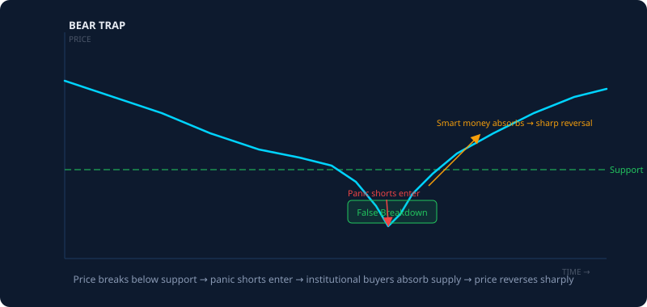

# The Bear Trap: How Panic Shorts Get Squeezed

Published May 26, 2026 · AION Analytics (India) · Lokesh Gupta

Canonical version: <https://dashboard.aiondashboard.site/research/notes/bear-trap>

---
A bear trap is a price move below support that attracts panic sellers and short-sellers — and then reverses violently upward, squeezing those positions. It is the structural mirror of the bull trap: designed to harvest overconfident directional bets on weakness.

AION Analytics visual: bear trap (right) and bull trap (left) — two sides of the same harvesting mechanism.

## The mechanics of a bear trap

Support is a price level where previous buying pressure was sufficient to stop a decline. Participants who sold short near a prior high, or who are running systematic strategies that go short on breakdown below support, are positioned to profit if price stays below the level.

A bear trap exploits this positioning by creating a brief push below support — triggering stop-sell orders and short-entry orders simultaneously — and then reversing sharply upward. The sequence:

1.  Price approaches well-watched support after a decline. Short-sellers position in anticipation of a break below.
2.  Price pushes below support, triggering both stop-losses for longs and short-entry orders for bears.
3.  Volume during the break is typically thin or concentrated into a single candle — not sustained selling over multiple sessions.
4.  Institutional buyers absorb the supply at the depressed prices. This absorption may not be visible in real-time — it shows up in the price action that follows.
5.  Price reverses sharply above support. Short positions are squeezed: their losses mount as price rises, and covering the position (buying) accelerates the reversal further.

## The short squeeze amplifier

Bear traps are more violent than bull traps because of the short squeeze dynamic. A trapped long holder can hold their position and wait for a recovery. A trapped short holder faces compounding losses as price rises — there is no ceiling on how much a short position can lose in theory. This creates mechanical buying pressure as shorts cover, which further accelerates the reversal.

In Indian markets, this dynamic is visible in F&O data. When short OI (put-to-call ratio skewed toward puts, or high short futures OI) is at extremes and price fails to make new lows after multiple attempts, the conditions for a bear trap reversal are mature.

## Identifying trap conditions before entry

The same framework applies to bear traps as to bull traps — check for structural weakness in the apparent signal:

- **Sustained vs. single-candle breakdown:** A genuine bearish breakdown typically develops over multiple sessions with consistent seller participation. A single candle breach of support on average or below-average volume is a trap candidate.
- **High put OI at or below the support strike:** Heavy put open interest below a support level means many participants have already positioned short. That positioning has been "earned" by the market. Once shorts are fully on, the incentive to continue pushing lower is reduced — there are no new bears to recruit.
- **Divergence in momentum indicators:** Price making a lower low while RSI makes a higher low is a classic bearish-momentum divergence that precedes reversals. The selling is losing internal strength even as price appears to be breaking down.
- **Rapid reversal candle within the session:** A long wick that pierces below support and closes back above it in the same session is the clearest trap signature. The intraday breach flushed out stop-losses, and the session closed without the sellers maintaining control.

## The emotional mechanics

Bear traps work in the same emotional environment as bull traps — panic and the fear of missing a move.

When markets are declining and a key support level breaks, the narrative shifts to "the decline is accelerating, this could be the big crash." The emotional pull is to join the trend — to short the breakdown because it feels like the obvious move. That urge, at the moment of maximum apparent bearishness, is precisely when the bear trap is being set.

The discipline required is to wait for confirmation of continuation (sustained selling, not a single break) before entering the short side. The cost of missing the first 5% of a genuine breakdown is recoverable. The cost of being trapped in a 15% reversal squeeze is not.

Bear trapPanic shortingShort squeezeReversalMarket microstructureSupport

