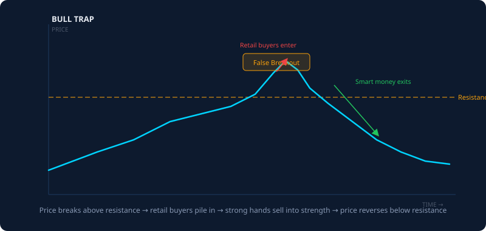
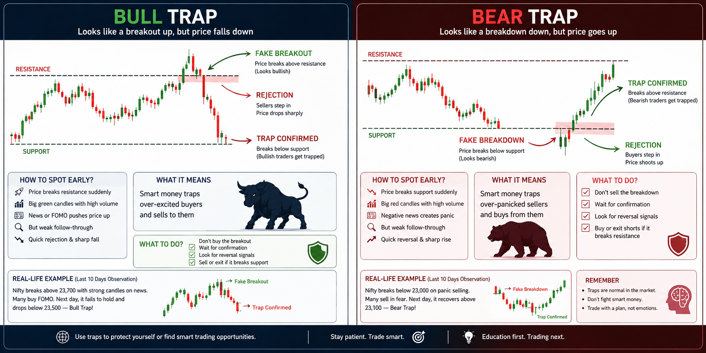

# The Bull Trap: How Breakout Buyers Get Harvested

Published May 26, 2026 · AION Analytics (India) · Lokesh Gupta

Canonical version: <https://aionanalytics.in/research/notes/bull-trap>

---
A bull trap is a price move above resistance that attracts breakout buyers — and then reverses, leaving those buyers with losses. The pattern is structural, not random: it exploits the confirmation-bias tendency to treat price action above a key level as validation of bullish momentum.

AION Analytics visual: bull trap (left) and bear trap (right) — price action that harvests the majority before reversing.

## The mechanics, step by step

Resistance is a price level where previous selling pressure was sufficient to stop a rally. The reason it exists is straightforward: sellers who bought above that level and watched price fall back were waiting at that level to exit without loss ("get me out even"). When price revisits the level, those sellers are ready.

A breakout above resistance is the signal most retail technical participants wait for. The logic seems clean: the sellers have been absorbed, the level is now support, and the move has room above. Buy the breakout.

The bull trap exploits this logic by creating a brief, engineered push above resistance — enough to trigger those breakout buy orders — and then reversing. The sequence is:

1.  Price approaches well-watched resistance. Retail expectation of a breakout builds.
2.  Price pushes above resistance — often by a small margin — triggering stop-buy orders and breakout entries simultaneously.
3.  Volume is thin during the breakout. The push is not supported by genuine buying conviction at scale.
4.  Price reverses below the resistance level within hours (or minutes on intraday charts).
5.  Breakout buyers are now trapped: they bought above resistance which has failed to act as support, and must choose between holding a losing position or taking the loss.

## What distinguishes a genuine breakout from a trap

Genuine breakouts have observable characteristics that differ from traps. Checking these before entering reduces but does not eliminate trap risk:

- **Volume confirmation:** A genuine breakout typically occurs on volume 1.5–2× the 20-day average at the session of the break. A trap often breaks on below-average volume, because the push is not backed by institutional conviction.
- **Candle structure:** A breakout candle that closes well above resistance (not just ticking through intraday) is more credible than one that closes at or just above the level. Wicks that spike above but close below resistance are almost always traps.
- **Options OI:** If the strike at or above the resistance level has very high call open interest, market makers who are short those calls have an incentive to suppress price at that level. Heavy call OI above a resistance is a flag for trap risk, not a signal of a coming breakout.
- **Broader market context:** A breakout in an individual stock or sector happening while broader indices are weak or choppy lacks structural tailwind. Traps are more common in these environments.

## The behavioural component

Bull traps are effective because they exploit two cognitive tendencies simultaneously:

**Confirmation bias:** Participants who are already bullish see the breakout as confirmation of what they expected and enter with higher conviction — exactly when skepticism is most warranted.

**Fear of missing out:** Participants who hesitated to buy the build-up feel urgency to enter once the level is broken, because they fear the move is "confirmed" and they are already late. This urgency compresses their entry criteria and causes them to skip the confirmation steps described above.

The trap works because the entry signals look strongest at the moment of maximum trap risk. The most obvious breakout is often the most engineered one.

## Position discipline after a trap is suspected

Once price reverses below the breakout level, the thesis that justified entry is invalidated. The breakout did not hold. Staying in the position because "it might recover" is not a thesis — it is hope. In this structure, disciplined participants typically treat a violated entry condition as a point to step back and re-evaluate rather than add exposure.

Bull trapBreakout failureLiquidity sweepConfirmation biasMarket microstructureF&O

