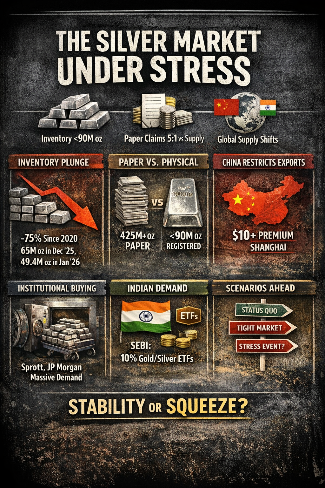

# The Dollar-Metals Dynamic: A Factual Framework

AION Analytics (India) · Lokesh Gupta

Canonical version: <https://dashboard.aiondashboard.site/research/notes/dollar-metals-dynamic>

---
The historical inverse relationship between the US Dollar Index and precious metals is one of the most studied correlations in global finance. In early 2026, that correlation reached -96% — a level observed only seven times since 1990. This note explains the mechanics, the conditions that produce extreme readings, and what historical patterns suggest follows.

**Macro arc:** This note is part of a connected set examining the structural cracks beneath India's growth narrative and the metals/sovereignty implications that follow.  
Arc: [Great Indian Illusion](https://dashboard.aiondashboard.site/research/notes/great-indian-illusion) → [Who Lost in a Crash](https://dashboard.aiondashboard.site/research/notes/who-lost-in-crash) → [Dollar-Metals Dynamic](https://dashboard.aiondashboard.site/research/notes/dollar-metals-dynamic) → [Gold-Silver Ratio](https://dashboard.aiondashboard.site/research/notes/gold-silver-ratio-hypothesis) → [GII Part 2: Gold](https://dashboard.aiondashboard.site/research/notes/great-indian-illusion-gold)

Silver market stress visualisation — March 19, 2026. Silver stress events often precede or accompany dollar-metals correlation extremes.

## The core relationship

Over the past 20+ years, gold and the US Dollar Index (DXY) have exhibited a persistent negative correlation. When the dollar weakens, gold prices tend to rise, and vice versa. The mechanism is not arbitrary.

Gold is priced globally in US dollars. When the dollar weakens, the same ounce of gold costs more dollars — its USD price rises. When the dollar strengthens, the same ounce costs fewer dollars — its USD price falls. This mechanical relationship is the floor of the inverse correlation.

Beyond the mechanical floor, there is a structural layer: when the dollar weakens because of US fiscal stress, monetary policy uncertainty, or geopolitical reserve diversification, the same conditions that weaken the dollar tend to drive demand for gold as an alternative store of value. The correlation strengthens in these environments because both forces — the mechanical pricing effect and the demand effect — move in the same direction.

## The 2026 reading and what it means

When the DXY-gold correlation reaches -96%, it means approximately 96% of the daily variance in gold prices can be explained by the movement of the dollar alone. This is near the theoretical maximum of the mechanical relationship.

Historical analysis of the seven prior occasions when this correlation reached this level shows a consistent pattern: the extreme reading is followed within 3-6 months by a correlation normalisation, typically as either gold consolidates or the dollar stabilises. During the normalisation period, silver tends to outperform gold — historically by 15-25% on a relative basis — because silver's industrial demand component provides an additional demand floor that pure monetary metals (gold) do not have.

## Why India is specifically exposed

India's exposure to the dollar-metals dynamic runs through multiple channels:

- **Current account:** India is the world's second-largest gold importer. A rising gold price in USD terms, combined with a depreciating rupee, means the INR import cost of gold rises faster than the USD gold price. This widens the current account deficit.
- **Monetary policy:** Rising gold import costs reduce the RBI's room for rate cuts, because imported inflation is harder to address through domestic monetary policy than domestic inflation.
- **Household savings allocation:** Indian households allocate a significant portion of savings to physical gold. A strong gold price in INR terms encourages this allocation, which draws savings away from the formal banking system and increases current account pressure simultaneously.
- **Silver industrial demand:** India has growing solar energy manufacturing capacity, and silver is a key component in solar panels. Rising silver prices increase the input cost for Indian solar manufacturers — a domestic industrial exposure that did not exist at meaningful scale a decade ago.

## The geopolitical dimension

The 2026 correlation extreme is not occurring in a neutral macroeconomic environment. It is occurring alongside reserve currency diversification by BRICS+ economies, US fiscal deficit expansion, and a restructuring of global trade settlement practices that was documented in the <a href="https://ssrn.com/abstract=6449739" target="_blank" rel="noreferrer">Asymmetric Multipolarity paper</a>.

When reserve managers diversify away from US Treasuries into gold — as central banks did in 2022, 2023, 2024, and 2025 — they are simultaneously weakening the dollar and strengthening gold demand. The correlation extreme is partly a reflection of this structural demand shift, not only market sentiment.

This distinction matters for how long the dynamic persists. Sentiment shifts revert quickly. Structural reserve diversification shifts persist over years.

GoldSilverDXYUS DollarPrecious metalsMacro correlationGeopolitics

