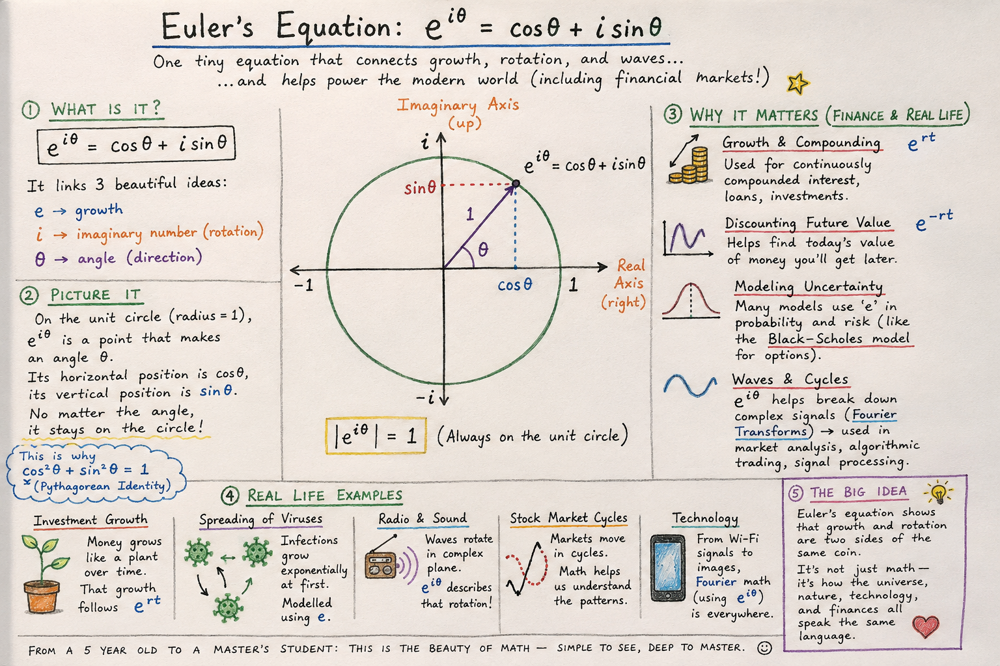

# Euler's Equation and Why Financial Markets Are Built on It

Published May 29, 2026 · AION Analytics (India) · Lokesh Gupta

Canonical version: <https://dashboard.aiondashboard.site/research/notes/eulers-equation>

---
e^(iπ) + 1 = 0. Five constants, one equation, and the mathematical backbone of modern finance. This is not a formula to memorise — it is a map to how growth, decay, cycles, and probability are all connected, and why that connection is fundamental to every pricing model, discounting function, and risk measure in financial markets.

AION Analytics visual: the five constants and their financial market connections.

## The five constants

Euler's identity connects five numbers that appear to have nothing to do with each other:

- **e ≈ 2.718...** — the base of natural logarithms; describes continuous exponential growth or decay.
- **i = √(−1)** — the imaginary unit; allows mathematics to describe rotation and oscillation.
- **π ≈ 3.14159...** — the ratio of circle circumference to diameter; describes cycles and periodicity.
- **1** — the multiplicative identity.
- **0** — the additive identity.

The equation says: raise e to the power of (i × π), and you get exactly −1. Add 1 to that, and you get exactly 0. The result is not approximate — it is exact.

## What it describes geometrically

The expression e^(iθ) describes a rotation through angle θ in the complex plane. As θ increases from 0 to 2π, the point e^(iθ) traces a perfect unit circle. This is Euler's formula: *e^(iθ) = cos(θ) + i·sin(θ)*.

At θ = π, the point has rotated halfway around the circle, landing at −1. That is all the identity is saying geometrically. The profound part is that exponential growth (e^x), rotation in two dimensions (i), and cycles (π) are the same mathematical object expressed differently. The universe does not distinguish between them.

## The financial market connections

### Continuous compounding and discounting

In finance, the present value of a future cash flow C received after time T at continuous rate r is: *PV = C · e^(−rT)*. The e function appears directly. Every bond price, every option model, and every DCF analysis uses this.

The discrete-time approximation (1+r)^T converges to e^(rT) as the compounding frequency increases. Continuous compounding is not a theoretical idealisation — it is what the continuous-time option models require, because price processes move continuously.

### The Black-Scholes formula

The Black-Scholes option price formula contains both e^(−rT) (the discounting term) and terms involving e^(−x²/2) (the Gaussian probability density). The Gaussian itself is the probability distribution that emerges from Bachelier's random walk model — and the Gaussian is derivable from the complex exponential e^(ix) via the Fourier transform.

The lineage is direct: Euler → complex exponentials → Fourier transforms → Gaussian probability density → Bachelier → Black-Scholes. Euler's equation is not adjacent to financial mathematics. It is foundational to it.

### Fourier transforms and cycle decomposition

Any periodic signal can be decomposed into a sum of sine and cosine waves of different frequencies. The mathematical tool that performs this decomposition is the Fourier transform, and it is built entirely from e^(iωt) — the complex exponential.

In financial applications: time-series data for prices, volatility, and volume contains periodic components — intraday cycles, weekly patterns, seasonal effects. Fourier decomposition separates signal (repeating patterns) from noise (random variation). Feature engineering for machine learning models applied to financial data routinely uses Fourier components. The tool is Euler's formula applied to time series.

## Why it matters for anyone building financial infrastructure

Mathematics that appears abstract at the formula level turns concrete at the implementation level. A developer building a discounting engine uses e^(−rT) without necessarily knowing its geometric meaning. A quant building a volatility surface fits a model whose probability distributions derive from the Gaussian, which derives from Euler's complex exponential.

Understanding the lineage does not change the implementation — but it changes the ability to reason about model failure modes. When a pricing model produces unexpected results in extreme conditions, the ability to trace backwards through the mathematical assumptions (Gaussian price distribution, continuous compounding, constant volatility) and understand which assumption is violated is the difference between diagnosing the failure and being surprised by it.

Euler's equationFourier transformsComplex numbersDiscountingProbabilityQuant foundationsFinancial mathematics

