# The FII-DII Headline Is Lagging: What Actually Moved the Market on April 8

Published June 22, 2026 · AION Analytics (India) · Lokesh Gupta

Canonical version: <https://dashboard.aiondashboard.site/research/notes/fii-dii-headline-myth>

---
On April 8, 2026, FIIs net-sold ₹8,692 crore in cash equities. Nifty still closed up ~3.85% (+890 points). The cash headline wasn't wrong — it was incomplete. This note explains the three layers the daily FII-DII number structurally cannot see.

## The most-quoted, most-incomplete number in Indian markets

Every trading evening, the NSE and BSE publish daily FII and DII net buy/sell figures for cash equities. These numbers are picked up immediately: "FIIs sold ₹X,XXX crore today" appears on every business channel, every market wrap, every WhatsApp group before the closing bell has cooled down.

The problem is not that the number is wrong. It is that it is narrow — and markets do not move on narrow data.

The cash equity figure captures one instrument, one session, one participant category. It excludes index futures, options, derivatives position roll-overs, and the structural domestic bid that has been quietly absorbing institutional selling for two years. Treating this one number as a market direction signal is one of the most durable analytical errors in Indian retail participation.

April 8, 2026 is the clearest worked example of the year.

## What actually happened on April 8

The prior session (April 7) cash flow data — the figures typically reported as the "daily FII-DII number" on April 8 — showed:

FII cash (Apr 7)

−₹8,692 cr

Net sellers, cash equities

DII cash (Apr 7)

+₹7,979 cr

Net buyers, cash equities

Nifty close (Apr 8)

24,014

+~890 pts (+~3.85%)

Sensex close (Apr 8)

77,605

+~2,988 pts (+~4%)

The headline read: FIIs are selling, markets might stay pressured. The actual outcome: one of the sharpest single-session rallies of the year, broad-based, with aviation, construction, autos, consumer finance, and cement all participating. InterGlobe Aviation was up approximately 10%; L&T, Bajaj Finance, Maruti, UltraTech, and M&M were among the wide group of large-cap movers.

The trigger was clear. A confirmed US-Iran two-week ceasefire collapsed Brent crude approximately 13.7% to around \$94.44 — a geopolitical risk-premium shock. India, which imports the majority of its crude, repriced immediately across energy-sensitive sectors.

**The data wasn't contradictory. It was incomplete.** FIIs sold cash equities on April 7. The market still surged on April 8. Both facts are true. The explanation is that the cash number tells you one slice of positioning — not total institutional stance, not the macro trigger, not the domestic absorbing capacity.

The FII-DII cash headline is visible but lagging. The real drivers — FII index futures positioning, India VIX compression, and combined domestic bid flow — operate below the surface. Apr 8, 2026 is the proof: the data wasn't contradictory; it was incomplete.

## The three layers the cash headline cannot see

### 1FII index-futures positioning

FIIs operate across instruments. An institution running a bearish macro view on Indian equities might hold short positions in Nifty index futures while simultaneously reducing cash equity exposure through selective selling. When the macro thesis reverses — a crude crash, a ceasefire, a Fed pivot — the first thing to unwind is the futures short.

Cash selling combined with futures short-covering is a net-bullish positioning shift. The institution is not entering the market through cash buys visible in the headline; they are closing the bearish derivative leg. The cash number shows the selling. The futures number, which is published separately and with less fanfare, captures the covering. Together they tell a different story than either alone.

On April 8, futures short-covering is the structurally coherent read — it aligns with a sharp, broad-based, risk-asset rally driven by an abrupt macro shift. This is the mechanism; the precise futures data is available in NSE's daily derivatives reports for participants who check.

### 2The volatility regime

The second signal the cash number cannot see is the volatility regime. India VIX — the implied volatility gauge derived from Nifty options — is a direct measure of how much risk premium the market is charging. When geopolitical risk is elevated (Middle East tension, crude supply uncertainty), VIX is elevated. When the source of that risk collapses — a ceasefire, a resolution — the risk premium reprices downward, often abruptly.

On April 8, India VIX fell sharply as the geopolitical risk premium collapsed. This is not a directional signal in itself; it is a structural repricing. Option writers who were long volatility began unwinding. Option buyers saw their positions revalued. The VIX move was the mechanical engine behind the speed of the rally — not just the FII-DII balance.

A sharp VIX decline on a positive macro trigger is a higher-signal event than any single cash flow figure. It means the entire risk-pricing architecture of the market is resetting, not just a participant category rotating.

### 3The full domestic bid

The DII cash figure (₹7,979 cr on April 7) understates the real domestic absorbing force. The full domestic bid in 2025-26 consists of:

- **Domestic institutional investors** — mutual funds, insurance funds, pension funds deploying mandated flows
- **Retail direct equity participants** — a structurally larger and stickier cohort than in any prior market cycle
- **SIP-driven systematic inflows** — monthly SIP contributions into equity mutual funds that deploy regardless of sentiment, providing a consistent bid under any sustained selloff
- **Proprietary and arbitrage desks** — institutional participants whose flows appear neither in the FII nor the DII line

The DII-cash number captures one layer of this. The structural story of Indian markets from 2023 onward is that the combined domestic bid has become large enough to absorb sustained FII selling without the market breaking — a regime shift that the old FII-net-sell-equals-market-down heuristic has not accounted for.

April 8 is one demonstration. The 2025 correction — where FIIs sold at scale for months while the Nifty ultimately held structural levels — is the full argument.

## The incomplete headline in full

| What the headline shows | What it cannot show | Why it matters |
|----|----|----|
| FII cash net buy/sell | FII futures and options positioning — often the larger and more structurally informative exposure | Cash selling + futures short-covering = net-bullish shift; the headline reads only the selling half |
| DII cash net buy/sell | Retail direct flows, SIP deployment, proprietary and arbitrage desk activity | The real domestic absorbing bid is 2–3x the DII-cash line; headline understates domestic structural depth |
| Prior-session data | The macro trigger driving the current session (crude, ceasefire, Fed, elections) | Flow data is lagging; the trigger is the leading signal. April 8 is driven by a crude collapse, not by the Apr 7 flow balance |
| Cash equity direction | Volatility regime (India VIX); risk-premium pricing across the options market | A sharp VIX decline often explains the speed and breadth of a rally better than any single flow figure |

## What to read instead

This is not an argument that FII-DII data is useless. Over multi-week periods, sustained net FII buying or selling does correlate with index direction. The error is treating a single session's cash figure as a directional signal for the next session — and ignoring the three broader inputs that actually drive intraday price discovery.

A more complete read at the start of any session:

1.  **What is the macro trigger today?** — Crude, Fed, domestic policy, geopolitical development. This is the leading signal. If a major macro input has shifted overnight, it will override the prior session's flow balance.
2.  **What is the volatility regime?** — India VIX above 20 signals a high-uncertainty environment; VIX falling from a spike signals risk-premium repricing. Neither tells you direction; both tell you the terrain.
3.  **What is the aggregate FII futures position trend?** — NSE publishes daily F&O participant-wise position data. Net FII index-futures long or short (and its change) is more informative than the cash headline for understanding institutional positioning direction.
4.  **What is the structural domestic bid doing?** — Monthly SIP inflows, mutual fund AUM trend, and retail participation data tell you whether the domestic absorbing capacity is growing or contracting. In the current cycle it is growing. That changes the interpretation of FII cash selling materially.

April 8, 2026 is not an anomaly. It is what happens when one part of the market reads a narrow number and the rest of the market reads the actual environment.

FII-DII flows Market microstructure India VIX Futures positioning Domestic bid Retail participation Market structure

