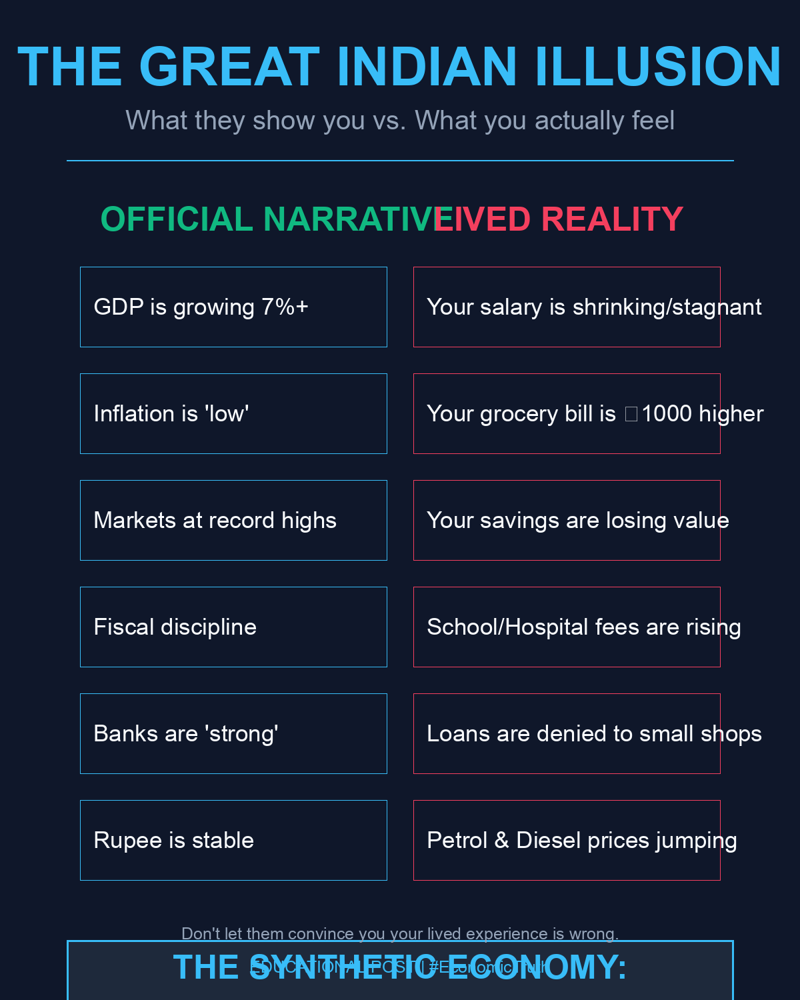

# The Great Indian Illusion: Five Structural Cracks

Published April 9, 2026 · AION Analytics (India) · Lokesh Gupta

Canonical version: <https://aionanalytics.in/research/notes/great-indian-illusion>

---
GDP is rising. Markets are elevated. But wages are flat, jobs are scarce, credit is tight, and household stress is building. This note maps five structural cracks between the headline narrative and the lived reality of the Indian economy.

The five-pillar illusion framework: each pillar shows what the headline says versus what is structurally happening.

## Pillar 1: Consumption without income

**What they show you:** GDP is up 7%. Markets are high.

**What is actually happening:** People are still buying some things but only because they are borrowing or spending savings. Income is not rising. If your salary does not increase but groceries still must be bought, you borrow or deplete savings. That is not economic strength. That is economic survival.

Urban consumption growth has been falling relative to the headline. Real wage growth in both formal and informal sectors has lagged CPI. The gap between nominal GDP growth and real household income growth is the illusion's first layer.

## Pillar 2: The government is building roads — but private companies are sitting on their cash

**What they show you:** Look at the new highways, airports, metro lines. Infrastructure investment is at record levels.

**What is actually happening:** The government is spending borrowed money to build things. But the large businesses — the ones that actually create permanent private-sector jobs — are not investing their own capital to build new factories or expand capacity. They are sitting on cash. They don't believe demand will materialise to justify the investment. So they wait.

This matters because government infrastructure spending creates construction jobs, which are temporary. It does not create the manufacturing, services, or technology jobs that sustain household income at scale. And governments borrow to fund this spending. When the borrowing reaches a ceiling — which it eventually must — even infrastructure spending slows. Private capex that never materialised cannot fill that gap overnight.

The question to ask: if business conditions are so good, why are the large industrialists not building new factories?

## Pillar 3: Banks look healthy on paper, but the loans are going bad

**What they show you:** Bank profits are up. NPA ratios are at multi-year lows. The RBI stress tests show resilience.

**What is actually happening:** The NPA numbers have improved partly because restructured loans were classified favourably during the COVID period, and partly because rising markets and collateral values inflated recovery assumptions. Small businesses that took post-COVID loans, households that took personal loans at high interest rates during the inflationary period of 2022–24, and microfinance borrowers are now beginning to default in rising numbers. The stress is visible in the microfinance NPA data and in the unsecured lending segments of consumer credit.

When banks sense rising credit risk, they tighten. They stop giving new loans to small shopkeepers, small manufacturers, and informal sector workers. This is the transmission channel from bank stress to real economy pain. It happens quietly, in loan rejection letters, before it shows up in any aggregate statistic.

The question to ask: if banks are so healthy, why are they refusing loans to small businesses?

## Pillar 4: The government is borrowing just to pay its old borrowings

**What they show you:** Fiscal discipline. Deficit targets met. Consolidation on track.

**What is actually happening:** A rising share of the government's annual budget is consumed by interest payments on accumulated debt — not by building new schools, hospitals, or skill-development programmes. The fiscal math is structural: as the debt stock grows, interest obligations grow with it, leaving less room for productive expenditure even within a nominally stable deficit.

The consequence is visible in public services. Government school infrastructure remains understaffed. Primary health centre capacity has not kept pace with population. Subsidies that protect household purchasing power — cooking gas, kerosene, fertiliser — become fiscally difficult to maintain when interest obligations crowd out the budget.

The question to ask: if the government is so disciplined with money, why are government hospitals still overloaded and public schools still underfunded?

## Pillar 5: The rupee and imported inflation

**What they show you:** The rupee is market-determined and orderly. FII inflows are supporting it.

**What is actually happening:** India imports crude oil, edible oils, electronics, semiconductors, and pharmaceuticals. Every rupee of depreciation against the dollar makes all of these more expensive in INR terms. The rupee has depreciated steadily over the past decade — not in a crisis, but structurally and continuously. The accumulated effect on household budgets is substantial: petrol, diesel, LPG, and the transport costs embedded in every vegetable and packaged product are all higher in real terms as a result.

The depreciation is largely invisible in the GDP number. It is moderately visible in the CPI basket. It is entirely visible in the monthly grocery bill of anyone who buys cooking oil, pays for transport, or depends on imported medicines.

## When all five crack at the same time

Each pillar is a structural stress in isolation. The risk is their interaction. The cascade that follows when multiple cracks converge:

1.  Oil hits a new high → petrol, diesel, and transport costs spike
2.  Transport cost passes through to food prices → household budgets compress further
3.  RBI raises rates to defend the rupee and contain inflation → home loan EMIs jump ₹3,000–₹5,000/month
4.  Households cut discretionary spending to service debt → consumer demand falls
5.  Demand falls → small businesses close, factory orders decline, more jobs lost
6.  Banks, already stressed, tighten lending → emergency credit unavailable, small business expansion stops
7.  Government has no fiscal room to stimulate → interest payments consume the budget; welfare schemes get cut
8.  Equity markets, which had priced in high earnings growth, reprice lower → the wealth effect reverses

This is not a prediction. Each step is a mechanical consequence of the preceding one. The timeline and severity depend on the magnitude of the triggering shock. But the structure of the cascade is not speculative — it follows directly from the five cracks described above.

## What the headline says vs what you actually experience

| What they tell you | What the data and lived experience show |
|----|----|
| GDP is growing at 7% | Real wages have not grown; household income pressure continues |
| Inflation is at 4–5% | Food inflation runs above headline; cumulative price levels are 15–20% higher since 2022 |
| Markets are at record highs | Mutual fund SIP returns are moderate; many equity portfolios are below inflation-adjusted breakeven |
| Fiscal discipline is strong | School fees, hospital costs, and utility bills rise faster than household income |
| Banks are strong and healthy | Small borrowers are being refused emergency loans; microfinance NPAs are rising |

## Why this matters for market participants

The illusion is not unique to India — every economy has a gap between headline statistics and lived experience. What makes the Indian version consequential for market participants is the *duration* of the divergence and its interaction with an equity market that has priced significant future earnings growth into current valuations.

When household stress reaches a level that constrains discretionary consumption, the earnings growth embedded in market prices does not materialise. That reconciliation is not a crash prediction — it is a structural observation about the relationship between the macro narrative and the micro reality.

AION’s sector-level intelligence models exist precisely because aggregate headline numbers obscure the distribution of impact. The five-crack framework is the lens through which sector-level events get read correctly rather than in isolation.

<a href="https://ssrn.com/abstract=6449739" class="ssrn-link" target="_blank" rel="noreferrer">Related: Asymmetric Multipolarity (SSRN, DOI: 10.2139/ssrn.6449739) →</a>

Political economyMacro riskIndiaHousehold stressGDPConsumptionWages

