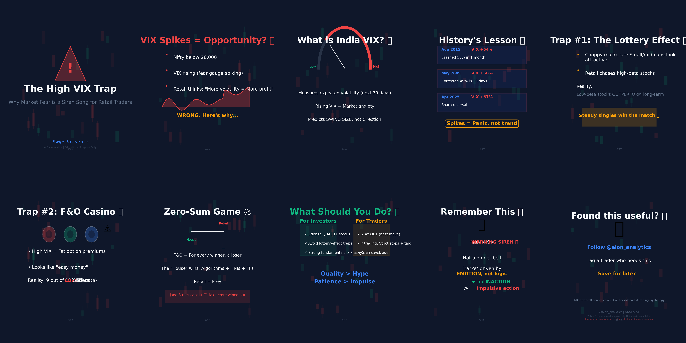

# The High VIX Trap: Why Market Fear Becomes a Siren Song

Published March 18, 2026 · AION Analytics (India) · Lokesh Gupta

Canonical version: <https://aionanalytics.in/research/notes/high-vix-trap>

---
A rising India VIX does not signal direction. It signals expected swing magnitude. This distinction determines whether a retail F&O trader is reading a warning or walking into a trap.

In recent weeks, the Indian stock market has turned distinctly choppy. The Nifty slipping below psychologically important levels changes the mood, and with it, the India VIX — our "fear gauge" — starts to spike. For many retail investors, a rising VIX looks like an opportunity: more movement means more chances to profit, right?

That logic is the trap.

AION carousel explainer: VIX mechanics and why high volatility traps retail F&O participants.

## What the India VIX actually measures

The India VIX measures the market's *expectation of volatility* over the next 30 days. A rising VIX does not mean prices will go up or down. It means the market is pricing in **larger swings in either direction**. The VIX is a magnitude signal, not a directional one.

This is the first and most important misread. A VIX at 20 does not tell you which way the market will move. It tells you the market expects moves roughly 20 points wide per day, annualised. Retail participants who treat a spike as a directional buy signal are responding to the wrong instrument entirely.

## Why high VIX inflates option premiums

Options are priced using implied volatility as a core input. When VIX rises, option premiums expand — both calls and puts become more expensive. This is structurally important because the premium expansion benefits option writers (who collect more), not option buyers (who pay more for the same exposure).

In a high VIX environment, the retail buyer pays an inflated premium for directional bets. If the market moves less than the VIX implied — which happens frequently, since VIX consistently overstates realised volatility during panic — the option expires worthless or at a loss even if direction was correct. The premium paid was the trap.

## Historical pattern: panic overshoot

In Indian markets, VIX spikes are frequently associated with systemic panic events — budget days, US Fed announcements, geopolitical shocks, or election results. In almost every case, the VIX peaks before the maximum pain in equities, and begins declining as institutional money re-enters.

The retail participant who waits for the VIX to spike before buying options tends to enter *after* the panic premium has already been priced in and *before* the implied volatility mean-reversion that follows. They buy expensive volatility at the top, and watch premiums collapse even if the index stabilises.

## What disciplined operators do differently

Experienced participants treat a VIX spike as a signal to evaluate *risk management posture*, not a signal to trade aggressively. Key responses differ:

- **Position sizing down:** High volatility regimes are defined by unpredictability. Reducing position size is a rational response to increased uncertainty, not a sign of weakness.
- **Premium collection, not premium buying:** If volatility is elevated, collecting premium by writing options (with defined risk parameters) tends to capture the overstatement of future realised volatility.
- **Waiting for the VIX to fall:** The safest directional trade after a panic is often taken after the VIX has already peaked and begun to fall — not during the spike itself.
- **Checking structural supports:** A genuine systemic shock (credit event, regulatory collapse) warrants different behaviour than a sentiment shock. Distinguish between them before acting.

## The F&O zero-sum framing

India's F&O market is among the largest retail-dominated derivative markets in the world by trade count. The structural reality of options is zero-sum: premium paid by buyers is premium received by writers. When VIX is high and retail buyers are paying elevated premiums, the other side of those trades is being taken by participants with better risk discipline and longer timeframes.

The SEBI data is unambiguous: the overwhelming majority of individual F&O participants lose money over multi-year periods. The VIX trap is one mechanism through which that transfer occurs. It is not random noise — it is a structural feature of how retail panic interacts with derivative pricing.

## One rule worth keeping

When India VIX is above 20 and rising, every option position should be sized as if the expected move is 1.5× what the chart suggests. When VIX is above 25, the cleanest position is often no new position at all. Market participation is not the same as trading discipline — sometimes staying out is the entire trade.

India VIXVolatilityF&O riskRetail behaviorOptions premiumRisk management

