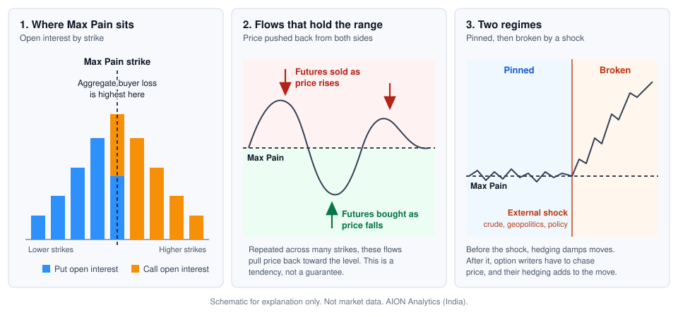

# Why Max Pain Matters (And When It Doesn't)

Published October 8, 2026 · AION Analytics (India) · Lokesh Gupta

Canonical version: <https://aionanalytics.in/research/notes/max-pain>

DOI: [10.5281/zenodo.23226815](https://doi.org/10.5281/zenodo.23226815)

---
Max Pain is the expiry price at which option buyers, taken together, lose the most. It is a tendency produced by positioning and hedging, not a law, and it fails when an outside shock moves the underlying.

Every expiry week, someone posts the Max Pain level for Nifty or Bank Nifty and says the index will close there. Sometimes it does. Often it does not. This note explains what the number is, why price sometimes drifts toward it, and the conditions under which it stops working.

## What Max Pain is

Max Pain is the expiry price at which the holders of options, taken together, receive the least. Put the other way round, it is the price at which option buyers as a group lose the most of the premium they paid, and option writers pay out the least.

It is computed from open interest, which is public. For each strike, assume the index expires exactly there. Work out what every open Call and every open Put would be worth at that price, multiply by the open interest, and add it all up. Repeat for every strike. The strike with the smallest total is Max Pain.

### A small worked example

Take three strikes only, with open interest in thousands of contracts. The numbers are invented to show the arithmetic.

| Strike | Call open interest | Put open interest | Total owed to buyers if expiry is here |
|---|---|---|---|
| 24,900 | 10 | 60 | 6,000 |
| 25,000 | 40 | 40 | 2,000 |
| 25,100 | 60 | 10 | 6,000 |

If the index expires at 25,000, the 24,900 Calls are worth 100 points on 10 thousand contracts, and the 25,100 Puts are worth 100 points on 10 thousand contracts. Everything else expires worthless. The total is 2,000, in points times thousand contracts. At 24,900 or 25,100 the total is 6,000. Max Pain in this example is 25,000.

Figure 1. Where Max Pain sits, the flows that hold price near it, and the two regimes. Schematic, not market data.

## It is a tendency, not a law

This is the part most people get wrong. Max Pain is not a law of physics. It is a pull that shows up only under specific conditions, and it is weak when those conditions are missing.

No desk can move an index to a chosen number. What the large option writers have is an incentive to keep price inside the range they have sold, and the positions to act on it. Two things then work in the same direction.

- **Strike defence.** When price approaches a heavily written strike, writers add to their positions there and adjust with futures. A rise toward the Call strikes is met with supply. A fall toward the Put strikes is met with demand.
- **Hedging by option holders.** Anyone who holds options and hedges them with futures has to sell futures as price rises and buy futures as price falls, simply to stay hedged.

Neither flow is aimed at the Max Pain number. But both lean against movement away from the strikes where open interest is concentrated, and that is where Max Pain usually sits. Repeated across hundreds of strikes in the last days before expiry, the result is a slow drift toward the level and a narrow range around it. Traders call this a pin.

### The pin depends on who holds the gamma

How strong a pin is comes down to one question: are the desks that hedge long gamma or short gamma? When they are long gamma, meaning they have bought options from the other side of the market, their hedging is mean-reverting by construction. They sell as price rises and buy as it falls. The pin is then at its strongest.

When they are short gamma, meaning they have sold the options, their hedging runs the other way and adds to every move. The pin then rests on strike defence alone, and it is at its weakest. This is the difference between a stable Max Pain pin and a gamma squeeze. Open interest does not show which of the two applies, which is one reason the same Max Pain reading can hold in one week and fail in the next.

## When Max Pain breaks

The pin holds only while the forces above are larger than whatever else is moving the market. It breaks when something from outside the options market moves the underlying: a jump in crude oil, a geopolitical event, an unexpected action by the Reserve Bank of India.

Once price has travelled through the written strikes, the picture reverses. A book that is short options has to buy futures as price rises and sell futures as price falls, because that is the only way to cover the options it has sold. Close to the pin this need is small and the writers manage it. After a shock it is large and urgent. The writers are no longer holding a range. They are chasing price.

The hedging that was damping moves now adds to them. This is why a Max Pain level, once it gives way, tends to be run over quickly and not revisited before expiry.

## Three things to look at first

Before giving any weight to a Max Pain number, three readings are worth checking.

1. **The distance between spot and Max Pain.** On a weekly expiry, if spot is more than about 1% away from Max Pain, the pull is weak. There is too much ground to cover and too little time.
2. **The put-call ratio.** A ratio above about 1.4 together with a tight range often comes before a move away from Max Pain. Heavy Put writing with high leverage is exposed to a squeeze if price slips.
3. **India VIX.** When implied volatility is falling, pinning tends to work. When implied volatility is rising, it tends to fail.

## What this note does not claim

The 1% and 1.4 figures are working rules of thumb used by practitioners. They are not the result of a published AION test, and no hit rate is claimed for them here. Open interest also has a limit that no calculation removes: it shows how many contracts are open at a strike, not who wrote them or who is hedged. Max Pain is therefore an estimate built on an assumption about who is on which side.

Read it as one description of how positioning is arranged going into expiry. It says where the writers would like price to finish. It does not say that price will finish there.

Max PainOpen interestOptions expiryHedging flowsPut-call ratioIndia VIX

