# OpenAlgo symtoken: 31 Brokers and Multi-Broker Execution

Published June 10, 2026 · AION Analytics (India) · Lokesh Gupta

Canonical version: <https://aionanalytics.in/research/notes/openalgo-symtoken>

---
OpenAlgo normalises order flow across 31 SEBI-registered brokers behind a single REST API. The key mechanism is elegant — and it contains a structural constraint that makes true multi-broker execution harder than it first appears.

OpenAlgo's per-broker symtoken table versus AION's retained cross-broker signal registry.

OpenAlgo is one of the most practical pieces of Indian fintech infrastructure available today. It normalises the order flow of 31 SEBI-registered brokers behind a single REST API without storing a gigantic universal schema for every broker. The key mechanism is a shared `symtoken` table and a set of per-broker master-contract downloaders. This architecture is both elegant and revealing.

## What the symtoken solves

Every broker assigns its own internal token to every tradeable instrument. Zerodha's token for NIFTY 50 November futures differs from Angel One's token for the same contract. Without normalisation, a system switching between brokers would need to maintain 31 separate lookup tables and rewrite every order before sending it.

OpenAlgo solves this with a unified `symtoken` table keyed on a canonical instrument string — symbol, exchange, instrument type, expiry, strike, and option type. When a signal arrives, OpenAlgo resolves the canonical string to the active broker's token in one lookup. This is the right abstraction for single-broker systems.

## The structural constraint

The `symtoken` table is populated when the user downloads the active broker's master contract. When the user switches brokers, the table is replaced. This means:

- Only one broker's tokens are resident at any time.
- Multi-broker fan-out (sending the same signal to two brokers simultaneously) requires either running multiple OpenAlgo instances or rebuilding the token table at switch time.
- If broker A is live and broker B's session token expires, the fallback to broker B requires a re-download of B's master contract before any order can be resolved.

## Why AION's approach differs

AION retains a cross-broker token registry across all active brokers simultaneously. Rather than replacing the token table on broker switch, AION caches only the live signal universe — the specific set of instruments the current signal engine might trade — with token mappings for every configured broker.

This makes three things possible that OpenAlgo's single-table approach does not support natively:

- **Instant broker switching:** The token for every instrument is already resolved for every broker. Switching execution targets from Zerodha to Upstox is a configuration change, not a token re-download.
- **Multi-broker fan-out:** The same signal can be routed to two brokers in parallel, each receiving the correct broker-specific token in its order payload.
- **Cross-broker validation:** Position reconciliation between brokers can be performed at the token level without a re-download cycle.

## Implications for Indian algo infrastructure

The symtoken design reflects a sensible prioritisation for OpenAlgo's primary use case: a single retail participant running one broker at a time with a clean REST interface. For that use case, it is nearly optimal.

Multi-broker execution — hedging across brokers, failover execution, distributed position management — requires a different layer above the per-broker token abstraction. That layer is the gap AION's registry is designed to fill.

Neither architecture is wrong. They solve different problems. Understanding the boundary between them is what prevents an engineer from expecting multi-broker behaviour from a single-broker abstraction.

OpenAlgoSymTokenBroker normalizationExecution infrastructureMulti-brokerIndian fintech

