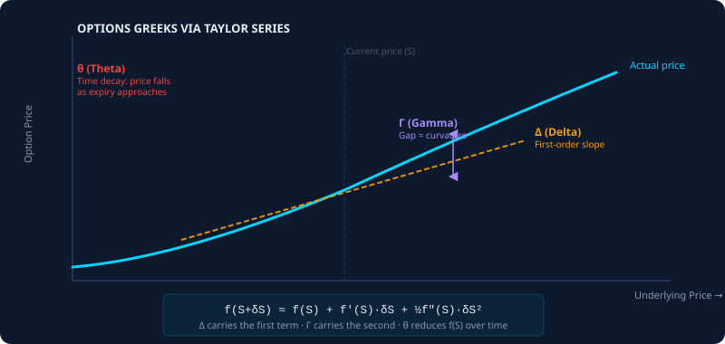
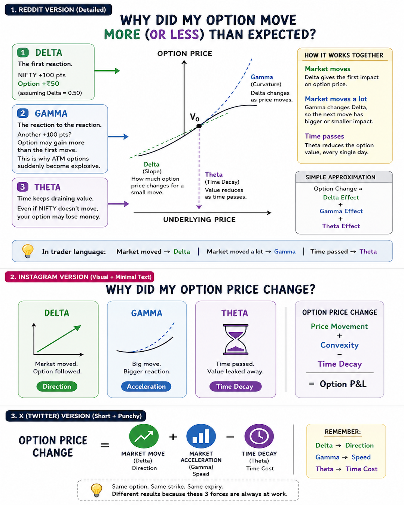

# Options Greeks Through the Taylor Series: Why Your Option Did Not Move as Expected

Published June 1, 2026 · AION Analytics (India) · Lokesh Gupta

Canonical version: <https://aionanalytics.in/research/notes/options-greeks-taylor-series>

---
An option position does not move linearly with the underlying. Delta, Gamma, Theta, and Vega are not arbitrary names — they are the terms of a Taylor expansion applied to the option pricing function. Understanding this derivation explains every unexpected option move and every model-vs-reality divergence you will encounter as an F&O participant.

AION Analytics visual: the Taylor series expansion applied to option pricing and the intuition behind each Greek.

## The Taylor series as an engineering tool

The Taylor series is one of the most powerful tools in applied mathematics. The core claim: if you know the value of a smooth function at one point and all its derivatives at that point, you can approximate its value at nearby points to arbitrary precision.

Formally, for a function *f* near a point *x₀*:

f(x₀ + δ) ≈ f(x₀) + f′(x₀)·δ + ½f″(x₀)·δ² + ⅙f‴(x₀)·δ³ + ...

In plain English: the function's value at a new point equals its current value, plus a first-order correction (how fast it is changing), plus a second-order correction (whether it is accelerating or decelerating), plus higher-order corrections that are usually small for small moves.

## Applying this to an option

An option's price is a function of multiple variables: the underlying price (S), time to expiry (T), volatility (σ), and interest rates (r). For a first approximation, consider only changes in S and T — the two dominant drivers of intraday option P&L.

The Taylor expansion of the option price *C(S, T)* around the current point is:

ΔC ≈ (∂C/∂S)·ΔS + ½(∂²C/∂S²)·ΔS² + (∂C/∂T)·ΔT

Replace the partial derivatives with the Greek names that options traders use:

- **∂C/∂S = Δ (Delta):** How much the option price changes for a one-unit change in the underlying. First-order sensitivity.
- **∂²C/∂S² = Γ (Gamma):** How much Delta itself changes for a one-unit change in the underlying. Second-order sensitivity — the curvature.
- **∂C/∂T = θ (Theta):** How much the option price changes as one unit of time passes, all else equal. Time decay.

So the P&L of an option position over a small time interval is approximately: *P&L ≈ Δ·ΔS + ½Γ·ΔS² + θ·Δt*.

## Why this explains the unexpected moves

### The Gamma effect: why the same move gives different results

Suppose the underlying moves 50 points. You expect your delta-neutral position to have zero P&L. But your position has significant Gamma, and the 50-point move produces a non-negligible ΔS² term. The second-order correction was significant, and you did not account for it.

This is the most common source of unexpected option P&L. Gamma is highest for at-the-money options near expiry. In the final week before expiry, the ½Γ·ΔS² term can dominate the total P&L even for modest underlying moves.

### The Theta effect: why time erodes even when direction is correct

You buy a call option because you expect the underlying to rise. The underlying rises 80 points, exactly as you predicted. Your call loses money.

This happens when the theta term (–θ·Δt) exceeds the delta term (Δ·ΔS). If you bought a far-out-of-the-money option with high time value and the underlying's move was insufficient to push the option into-the-money meaningfully, time decay consumed more value than the directional move created.

### Vega: the volatility sensitivity the Taylor expansion adds at the next level

Adding the volatility dimension to the Taylor expansion introduces a fourth term: **∂C/∂σ = ν (Vega)** — how much the option price changes for a one-percentage-point change in implied volatility. When IV compresses after a high-VIX period, even directionally correct options can lose value because the Vega-driven premium contraction overwhelms the Delta-driven P&L.

## The infrastructure implication

An execution system that monitors positions only through Delta is running a first-order model. It will systematically misjudge risk in high-Gamma environments (near-expiry, at-the-money positions) and in high-Vega environments (positions taken during volatility spikes). The Taylor series framework is the minimum viable risk model for any system managing multi-leg options positions.

OptionsDeltaGammaThetaVegaTaylor seriesF&ODerivatives mathematics

