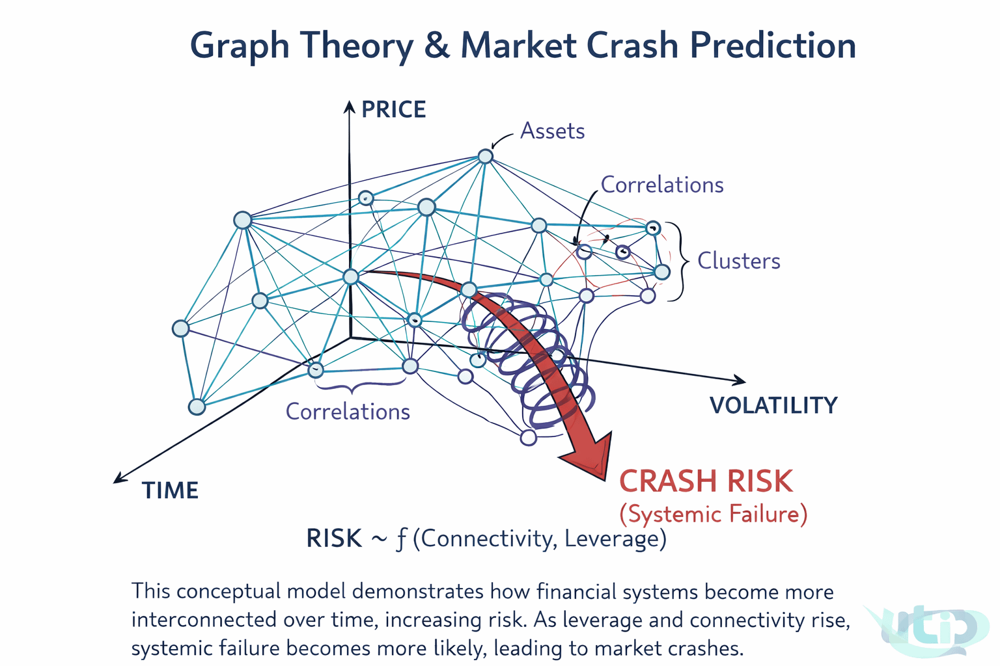

# Systemic Risk: Graph Theory and Market Crash Mechanics

AION Analytics (India) · Lokesh Gupta

Canonical version: <https://aionanalytics.in/research/notes/systemic-risk-graph-theory>

---
Financial risk is not additive — it is networked. Graph theory explains why locally sound institutions fail together: as connectivity and leverage increase across the financial system, the probability of systemic failure rises non-linearly.

Conceptual model: financial assets as nodes in a network evolving over time. As connectivity and leverage grow, crash risk (shown by the red arrow) becomes the dominant attractor. RISK ~ f(Connectivity, Leverage).

## The core proposition

Risk in financial markets increases as connectivity and leverage increase over time. This is not a claim about any individual asset or institution — it is a structural claim about the network as a whole.

The intuition is straightforward: a single bank holding bad loans is a credit problem. A hundred banks holding the same loans, levered against each other through derivatives, is a systemic problem. The loans did not change. What changed is the graph structure through which losses propagate.

## Assets as nodes, exposures as edges

Treat each institution, fund, exchange, or asset class as a node in a graph. Treat each financial relationship — a loan, a derivative contract, a collateral arrangement, a correlated position — as an edge between nodes. The weight of the edge represents the size of the exposure.

In normal conditions, most edges are thin. Most nodes are weakly connected to most other nodes. A failure at one node produces a local loss and stops. This is the functioning financial system in ordinary times.

During credit expansions, two things happen simultaneously:

- **Edge density increases:** More institutions take on exposure to each other through leverage, derivatives, and structured products. The graph becomes more connected.
- **Edge weights increase:** The size of individual exposures grows as leverage ratios expand. Each connection carries more potential loss per unit of stress.

## Correlation clusters and diversification failure

Diversification is the conventional response to idiosyncratic risk. Holding uncorrelated assets means a loss in one position does not propagate to others. This works in normal conditions because correlations between most asset classes are genuinely low in calm regimes.

During stress, correlations compress toward 1. The mechanism is forced selling: when levered participants face margin calls, they sell whatever is liquid, regardless of asset class. Selling equities, gold, and bonds simultaneously drives correlations between them toward unity — not because the assets are fundamentally related, but because the selling pressure is mechanical and simultaneous.

The graph at this point is no longer the graph that was used to construct the diversified portfolio. The edges that were assumed to be weak are now active and bidirectional.

## Volatility as a system state signal

The diagram maps three axes: time, price, and volatility. As the system moves forward in time, connectivity and leverage accumulate. Volatility begins to cluster. Small shocks produce increasingly large responses as the network's buffering capacity is consumed by existing exposures.

The transition from stable to unstable is not linear. Below a certain connectivity threshold, the system absorbs shocks. Above it, shocks amplify. The relationship between connectivity, leverage, and crash probability follows a non-linear function — which is why systemic crises consistently surprise markets that were measuring individual risk rather than network risk.

## What this implies for market infrastructure

The standard risk model in retail and institutional trading treats each position's risk independently, then sums. This additive approach works when correlations are stable. It fails precisely when it matters most — in stress regimes where correlations shift and the graph structure dominates individual position risk.

An infrastructure that reads macro events and sector impacts through a network lens — rather than flattening them into uncorrelated signals — is more likely to capture the actual risk being assumed in a portfolio. This is the structural motivation behind AION's sector-graph approach to market intelligence.

RISK ~ f(Connectivity, Leverage) is not just a formula on a diagram. It is the description of why every major financial crisis since 1987 has been more severe, faster, and more contagious than the models that preceded it predicted.

Graph theorySystemic riskLeverageContagionMarket crashesNetwork risk

